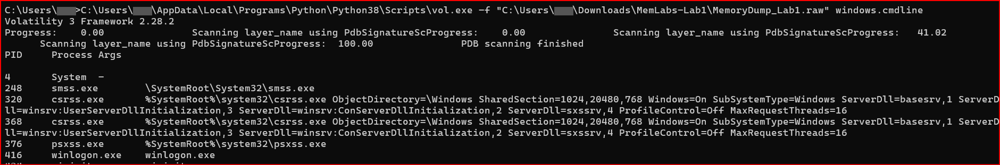
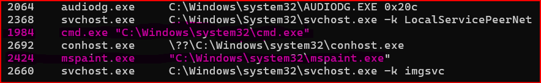
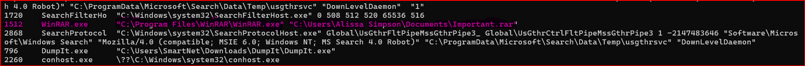
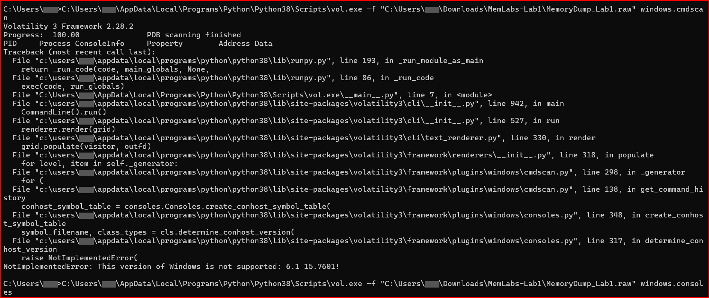
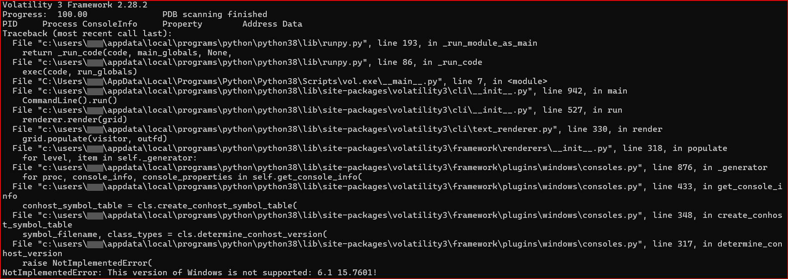
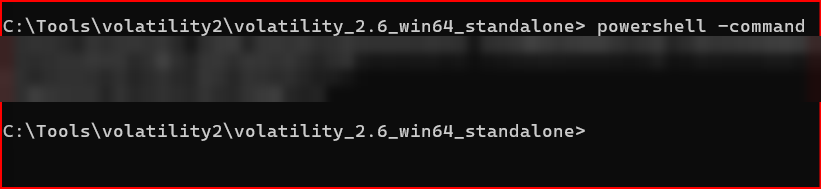
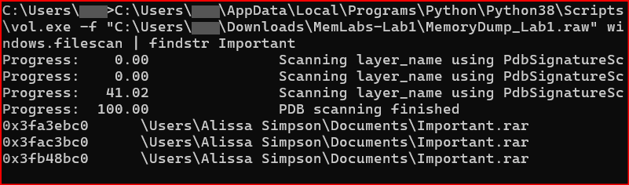
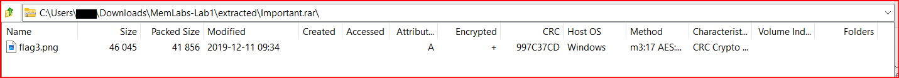
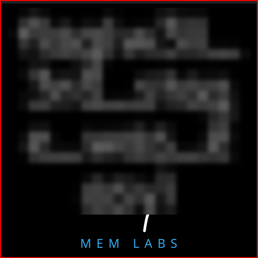
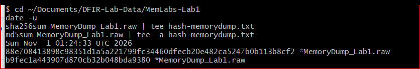

# Case 1: Turnabout Memories
### MemLabs Lab 1 memory forensics, Volatility

**Evidence:** `MemoryDump_Lab1.raw` (Windows 7 SP1 x64, about 1 GB) from [MemLabs](https://github.com/stuxnet999/MemLabs)
**Result:** 2 of 3 flags recovered

> Flag values are blurred on purpose, as a courtesy so others can solve the lab themselves. Flags 1 and 3 were found.

---

## Why memory first

I wanted to start my labs with a memory dump because it's volatile evidence. In a real investigation that's what we should check first, because volatile evidence can easily be lost.

## The scenario

A sister's computer crashed while she was working, and all that's left is a memory dump. There are three hidden flags. (A sister and a crash reminded me of the Ace Attorney case "Reunion, and Turnabout.")

## What was running

`windows.pslist` and `windows.cmdline` gave me the starting points:

- **cmd.exe** (PID 1984), a command prompt was open
- **mspaint.exe** (PID 2424), Paint was open when it crashed
- **WinRAR.exe** (PID 1512), opening `C:\Users\Alissa Simpson\Documents\Important.rar`
- **DumpIt.exe**, the tool that captured this memory, so that one is expected
- Two separate login sessions

**Two users.** I noted it but didn't assume. The command was typed by SmartNet on SMARTNET-PC, while the archive was in Alissa Simpson's Documents. The process list also showed two login sessions. It could be two people or two accounts on the same machine. The memory alone doesn't say which, so I wrote down what I saw and left it at that.

## Flag 1: the command prompt

I ran into an error with Volatility 3, a tool limitation: `cmdscan` and `consoles` don't support this Windows 7 build (`NotImplementedError: This version of Windows is not supported: 6.1 15.7601`). So I had to download Volatility 2.6 and run cmdscan again.

That was a speed bump, where I remembered to slow down but keep going and not stop altogether. It taught me that the newest version isn't always the best version.

In Volatility 2.6, `cmdscan` showed one typed command, `St4G3$1` ("Stage 1"), and `consoles` showed what was printed after it: a Base64 string. Base64 is encoding, not encryption, so I decoded it in PowerShell and got Flag 1.

For a detective it's always a "eureka" moment when something opens up. Like I found the key to a treasure box.

## Flag 3: Important.rar

`windows.filescan` found `Important.rar` at three places in memory.

Getting it out took a few tries. First Windows couldn't display a special character in one of the filenames, so I had to force Python to use UTF-8 (`set PYTHONIOENCODING=utf-8`). Then I took a break and came back to it. `--virtaddr` didn't work, `--physaddr` did, and the file came out of memory.

The archive was password protected. `hashdump` in Volatility 2.6 gave me the account hashes. Alissa Simpson's NT hash was the password, and inside was `flag3.png`.

## Flag 2: Paint (not solved yet)

Flag 2 is in Paint's memory. I dumped the mspaint process (`memdump -p 2424`), renamed it to `.data` and opened it in GIMP as raw image data, trying different widths and offsets to make the drawing show up.

GIMP was new to me, so playing with the numbers was fun but not very productive in the end. One thing that cost me time: GIMP's offset is in pixels, not bytes, so my offsets were off by a factor of 4 until I caught it. I found a small repeating icon and a big white area that looks like the blank canvas, but couldn't line up the drawing.

I'm leaving Flag 2 for now, but I will come back to it. Next time I'll search the dump for image headers instead of guessing widths and offsets.

## Integrity

I didn't hash the memory dump before I started. I hashed it after the analysis, so these values fix the image from now on, but they can't prove it was untouched before.

| File | Hash (taken 2026-11-01 01:24:33 UTC) |
|---|---|
| MemoryDump_Lab1.raw | SHA-256 `88e708413898c98351d1a5a221799fc34460dfecb20e482ca5247b0b113b8cf2` |
| | MD5 `b9fec1a443907d870cb32b048bda9380` |

## Lessons

1. The older version of Volatility worked and the newer one didn't, so never rely on just one tool version. Also, don't give up. If I had given up, I wouldn't have known the earlier version would work. Sometimes we have to explore a little.
2. Working on a case can cloud our focus, so taking a break and coming back with a fresh mind is important. Of course, chain of custody and integrity have to stay intact. Checking the hash after coming back is one way to make sure of that.

## Tools

Volatility 3 (`windows.info`, `pslist`, `cmdline`, `filescan`, `dumpfiles`), Volatility 2.6 standalone (`cmdscan`, `consoles`, `hashdump`, `memdump`), PowerShell for Base64, WinRAR, GIMP.
