# Case 2: Turnabout Spreadsheet ⚖️
### M57-Jean disk forensics case, Autopsy

**Case #:** 2026-001  **Examiner:** Fatema Johra  **Tool:** Autopsy 4.22.1
**Evidence:** `nps-2008-jean.E01/.E02` from [Digital Corpora](https://digitalcorpora.org/corpora/scenarios/m57-jean/)
**All times are UTC.**

---

## The case

M57.Biz is a small startup. A spreadsheet with the names, salaries and Social Security numbers of its employees showed up on a competitor's website. The only copy was supposed to be on the laptop of Jean, the CFO. Jean says she has no idea how it got out. She must have been hacked.

I chose this case because I wanted a puzzle big enough for me to investigate but small enough that I could investigate it from all angles, with no stone unturned. It was a small image I could work with in a reasonable amount of time, but also something that would give me skills and experience to investigate real cases later.

When I first read "Jean says she must have been hacked," I wanted to investigate it. I did not make any judgements, because I was trained to be unbiased in an investigation. I took a forensic science class during my master's program, and I had to visit a mock crime scene. In that report I was not even allowed to say we found "bloodstains," just "red stains," until forensic analysis confirmed it.

So I went in with four questions. Was it phishing? Was the laptop compromised? Was another user responsible? Or was it Jean?

## Evidence handling

I hashed the files for two reasons. One, so I could confirm I started investigating on a clean, untouched copy. Two, so after finishing my investigation I could confirm I made no changes to the image.

I kept a read-only copy on my D: drive as the original and only worked from a copy on C:.

| File | SHA-256 (before, 2026-10-27, and after, 2026-10-31) |
|---|---|
| nps-2008-jean.E01 | `df3a995c7a594e0ba6d95b9aae735a444313fae435a87e7536f9dad3db2769ce` |
| nps-2008-jean.E02 | `07f1f78c857d5b5809ac7a68e1467d36872fa74f047ee2c799d37b18aad4f5aa` |

Both matched at the end. The image was not changed.

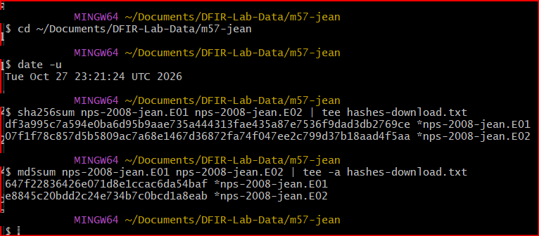
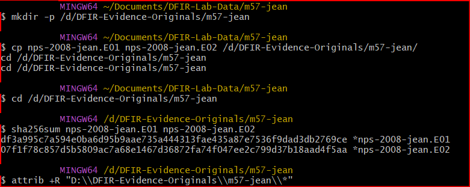
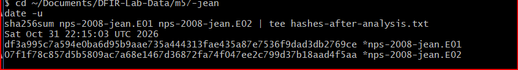

I knew I might run into issues with Autopsy because my version (4.14) was quite old, and it kept crashing on launch (`libtsk_jni ... Can't find dependent libraries`). I removed it and installed 4.22.1. But with every obstacle, we always learn two things: patience and new findings.

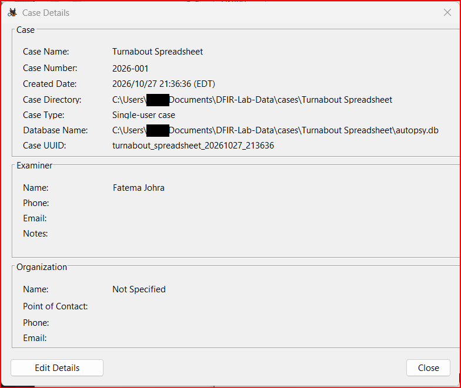
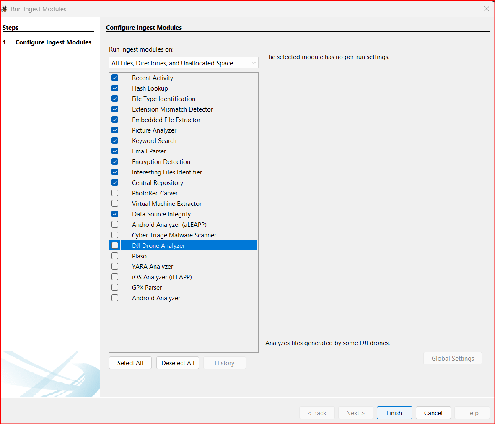

## The laptop

- Windows XP SP3, computer name `JEAN-13FBF038A3`
- It's a VMware virtual machine. VMware Tools went in 7 minutes after Windows, the CD drive is a VMware one, and the network card address has VMware's prefix. It piqued my interest and I wanted to dig deeper to see if I could find new information.
- Time zone is **GMT Standard Time** (London, UTC+1 in summer). I checked it in the registry instead of assuming.
- Last shutdown: **2008-07-21 01:31:32**, decoded from `ShutdownTime` and matching the registry hive file times.

I never want to assume anything. If my report is used in a trial, it could influence a person's guilty or not-guilty verdict, and as a result, that person's life.

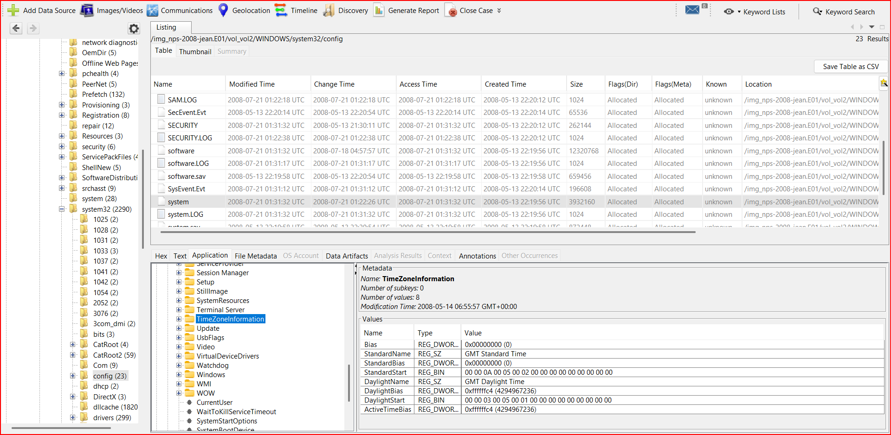
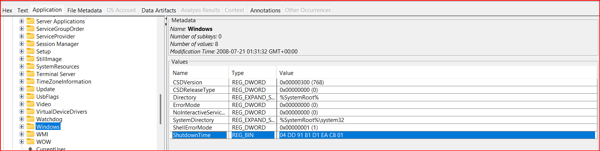

### Who used it

Staff accounts (kim, addison, abijah, sacha, devon, jean) were all created within 3 minutes on 2008-05-14. My first thought was foul play. But I did not find any foul play activity on the laptop: no suspicious payload, no emails with a suspicious attachment or link. The other accounts had no folders or activity, just the initial setup, except Devon.

Only three accounts ever logged in: Administrator, **Jean** (80 logins, admin) and **Devon** (4 logins, admin).

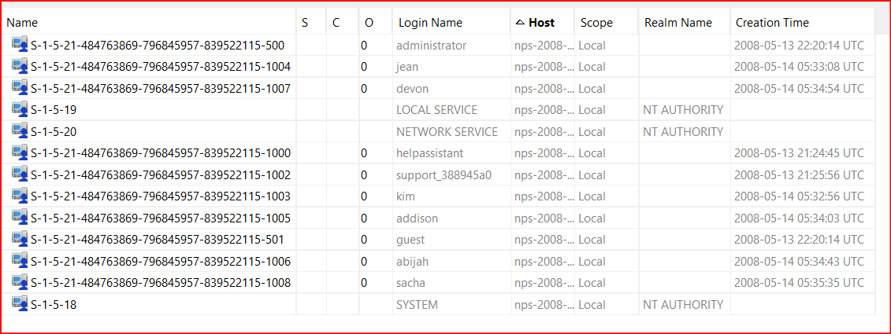
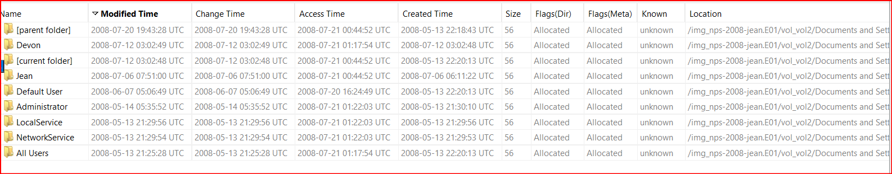
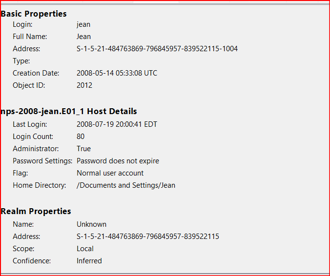
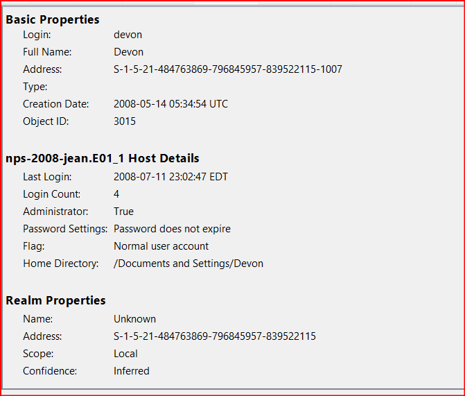

**Devon:** one session on 2008-07-12 (about 03:02 to 06:04), opened Outlook Express briefly, no documents. We did not find anything to suggest Devon was suspicious or innocent, so no comment on it. Four logins but only one session: I would like to find out the reason, but I understand that in a real case we don't always have the luxury of spending endless time on an investigation. We answered the question we were given: is Jean a victim or a suspect? We did not find evidence that Devon's logins have anything to do with the case, so that is a mystery to solve later.

## The spreadsheet

`m57biz.xls` was in two places with the same hash: Jean's Desktop, and attached to an email in Jean's `outlook.pst`.

| | MD5 | SHA-256 |
|---|---|---|
| Both copies | `e23a4eb7f2562f53e88c9dca8b26a153` | `34456b5f714dc9d8dd23c742d54c3f5f582ecb042bc1c4d3042b88203863779f` |

When I came across that file, I just wanted to find out what evidence I could find to build my case.

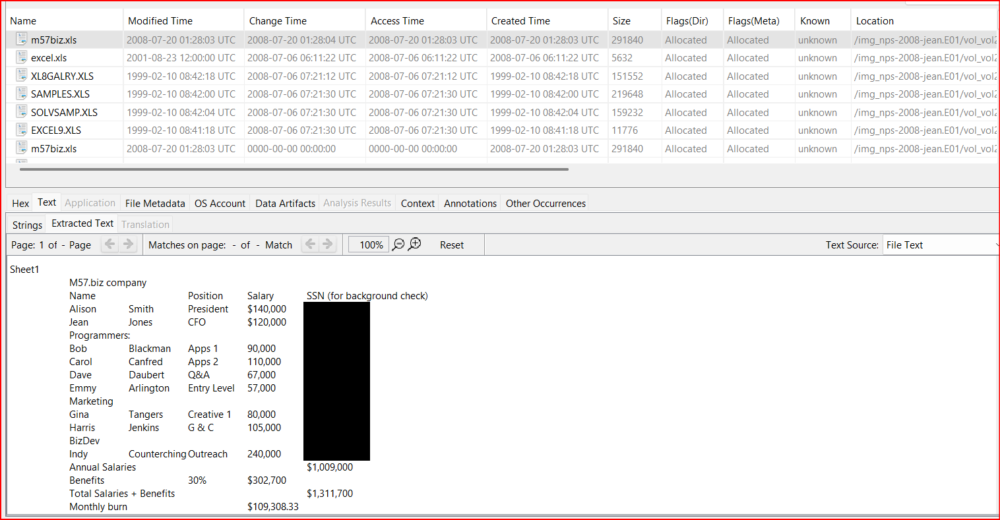
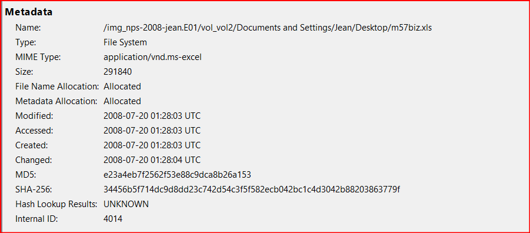
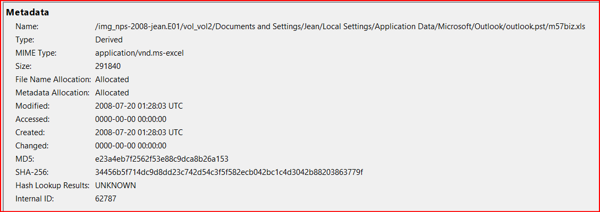

## The emails

What made it click for me was the Gmail account first, then the confused emails back and forth between Jean and Alison, and then the forged headers to back it up.

| Time | What happened |
|---|---|
| 07-19 23:32–23:50 | The real Alison's Outlook is misconfigured and sending as `alex@m57.biz`. Jean asks which address she's using and gets two different answers. |
| 07-19 23:39:57 | Forged "background checks" email from "alison@m57.biz" asks for every employee's name, salary and SSN for a potential investor. "Please do not mention this to anybody." "Please do not include the text of this email in your message to me." |
| 07-19 23:46 | Jean replies "Sure thing." It goes to the real Alison. |
| 07-19 23:50:20 | Real Alison: *"What's a 'sure thing.' ?"* No reply from Jean. |
| 07-20 01:22:45 | Follow-up from `tuckgorge@gmail.com` with "alison@m57.biz" as the display name: *"I really need that information now --- this VC guy is being very insistent."* |
| 07-20 01:28 | Jean replies with `m57biz.xls`. Her reply quotes `From: alison@m57.biz [mailto:tuckgorge@gmail.com]`. |
| 07-20 05:03:40 | "Thanks for the file. I'll handle it from here. Once again, please don't tell anyone about this." |

**The headers.** The real Alison's emails come from Outlook on a PC, with a full set of Microsoft headers and a +0100 time zone. The forged ones came from `xy.dreamhostps.com (Postfix, from userid 558838)`, a script on a web server, with a Return-Path that isn't an M57 address. Both attacker emails came from the same server and the same userid.

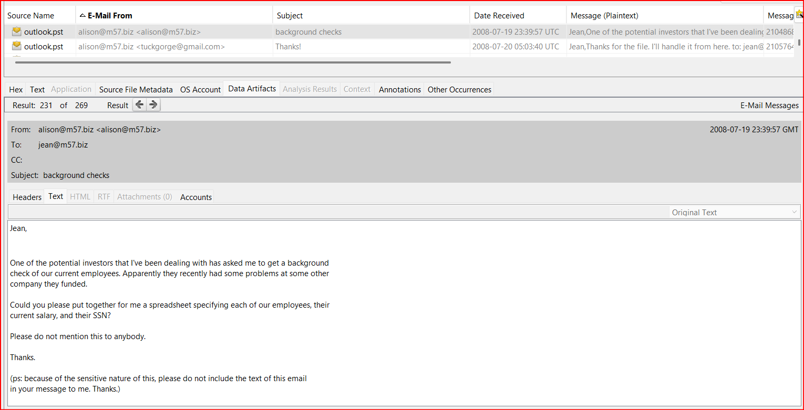
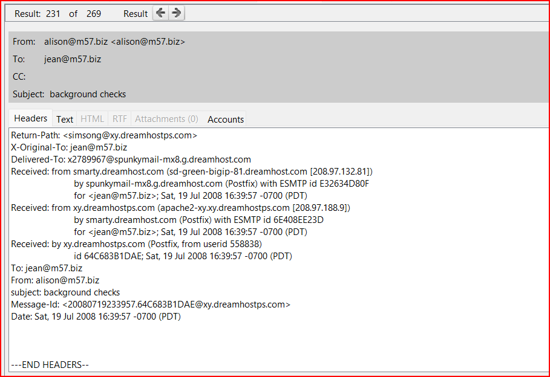
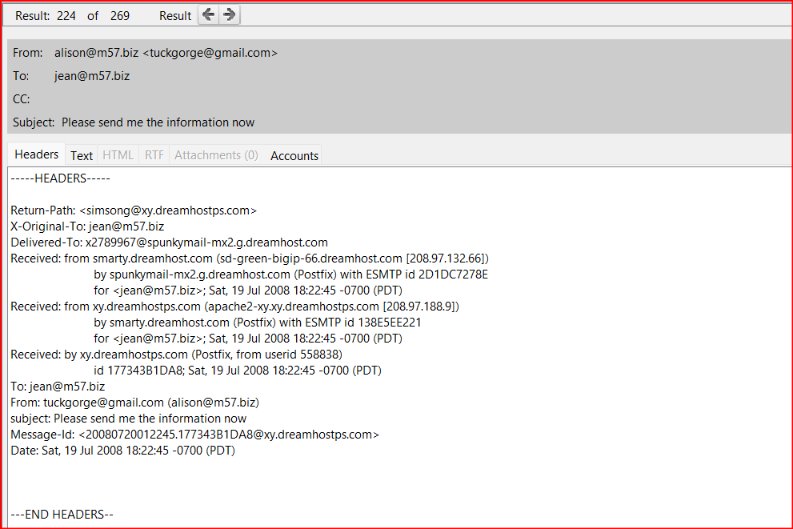
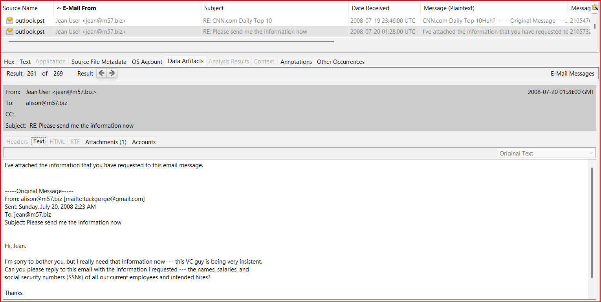
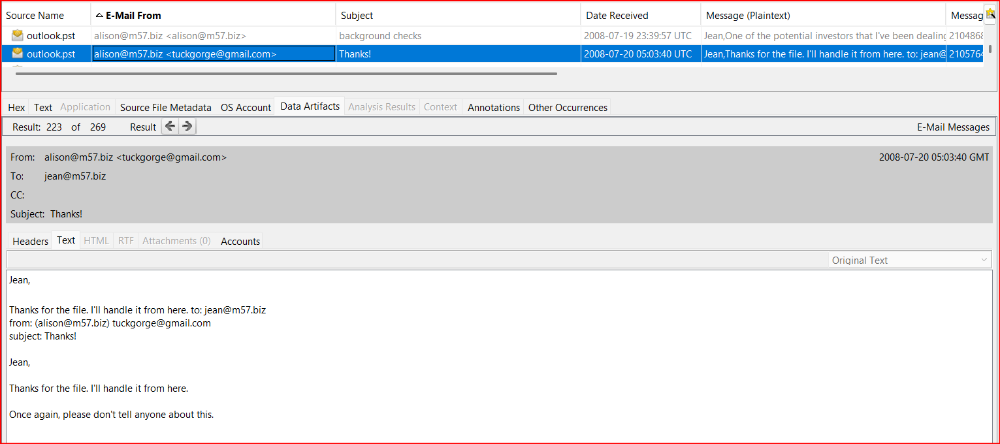
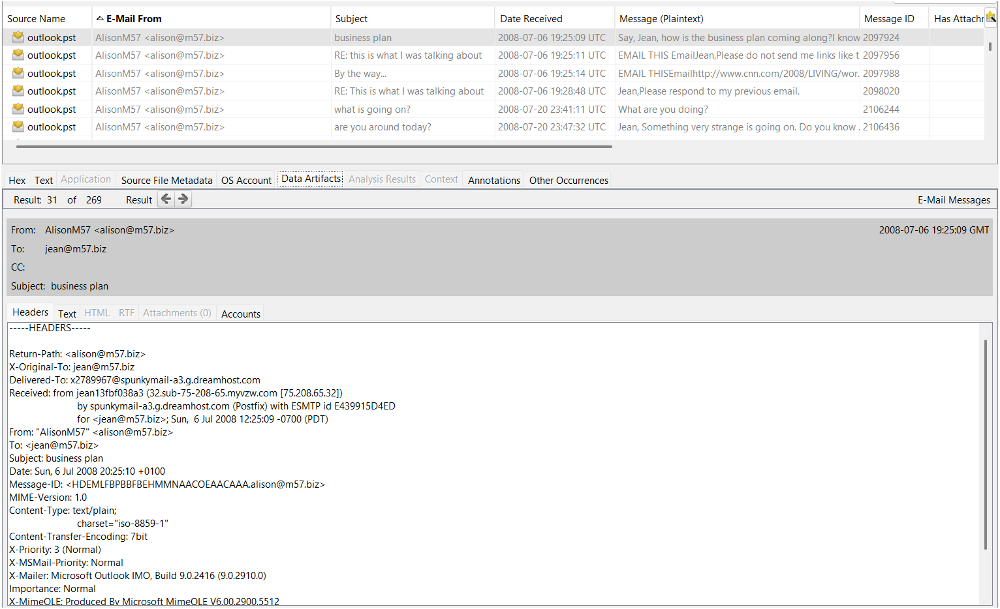

**The "alex" mix-up.** I dug into it to confirm two things: whether the attacker had been talking to Jean for a long time or only just before the leak, and whether the real Alison was really unaware of everything. All three "alex" emails share the same PC, IP and Outlook build as Alison's real emails, and the Message-IDs show her address changing from alex@ to alison@ mid-conversation. So it was the real Alison. The attacker's first contact was 07-19 23:39, the night of the leak.

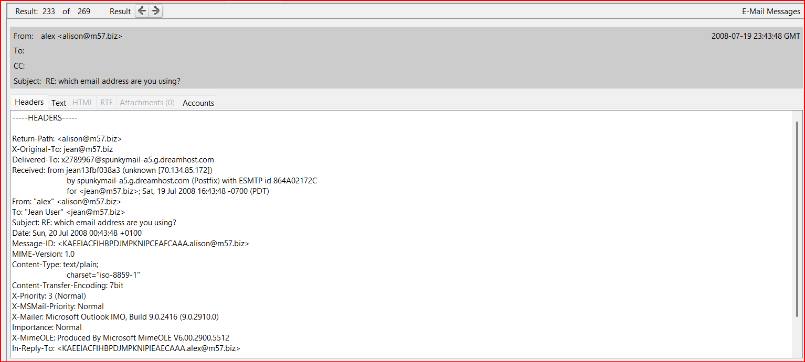

**"What's a 'sure thing.'?"** I looked for further emails between them, or any evidence that would give me a better picture, but found nothing.

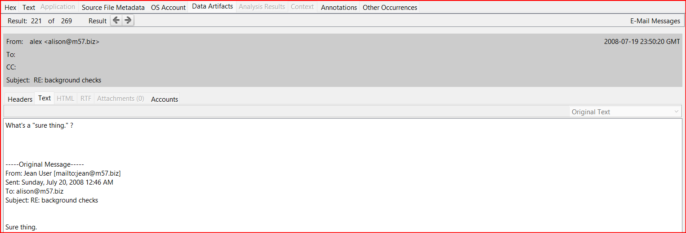

## Where did the file come from?

| Time | What happened | Source |
|---|---|---|
| 01:22:45 | Attacker's "send me the information now" arrives | outlook.pst |
| 01:26:17 | A USB flash drive is connected for the first time, becomes E: | MountedDevices, USB / USBSTOR keys |
| 01:27:04 | Office's file window used for the first time on Jean's profile | NTUSER.DAT `Open Find\Places` |
| 01:27:27 | Jean inserts a file into an email in Outlook | NTUSER.DAT `Outlook\Settings\Insert File` |
| 01:27:40 | Excel opens `Jean\Local Settings\Temp\m57biz.xls` | Prefetch |
| 01:28:03 | Save As to `Jean\Desktop\m57biz.xls` | NTFS times, NTUSER.DAT `Excel\Settings\Save As`, file metadata |
| 01:28:13 | Excel closes | NTUSER.DAT `Excel\Recent Files` |
| 01:28 | Reply with attachment sent | outlook.pst |

What the file itself says: **Author: Alison Smith. Created 2008-06-12 15:13:51. Last saved by Jean User, 2008-07-20 01:28:03. Company: M57.BIZ.** Jean's profile didn't exist until 07-06, so the spreadsheet came from outside this laptop.

Finding that out changed my picture. Jean didn't build the spreadsheet that night. It already existed. That gave me a new question: how did it get to Jean's Temp folder?

Excel didn't show up in UserAssist for that night, so Jean didn't start it from the Start menu. Another program started it. Outlook 2000 copies an attachment to Temp when you open it, so the most likely sequence is: Jean attached the file to her reply at 01:27:27, opened the attachment, did a Save As to her Desktop, and sent the reply.

The USB drive: I decoded `MountedDevices` myself to confirm it was E:, because Autopsy cut the value off. Even though it did not connect to the file, I still wanted to confirm it regardless. Leave no stone unturned! Nothing on the laptop references E:. Office's file window doesn't save the folder you browse to, so where the file was attached from at 01:27:27 is still unknown.

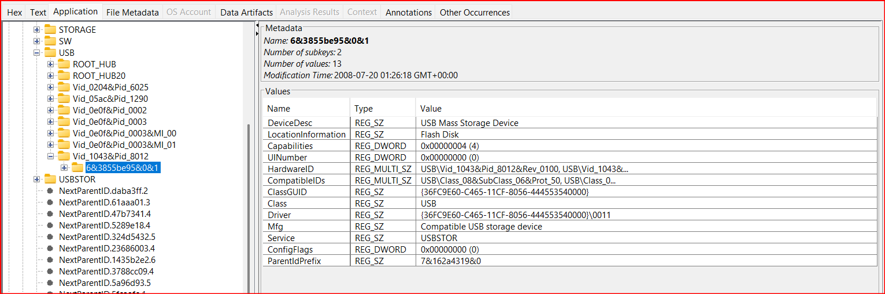
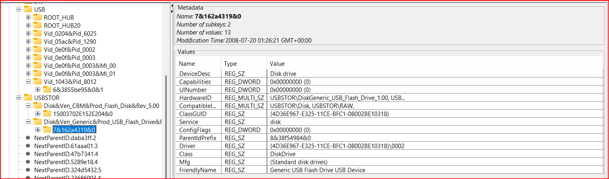
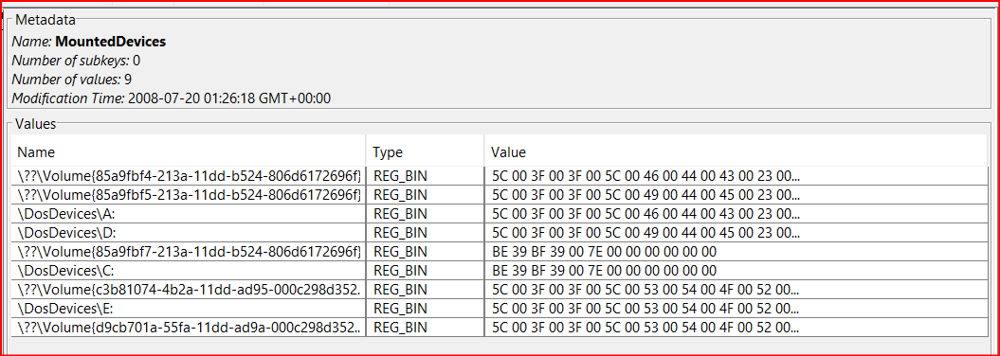
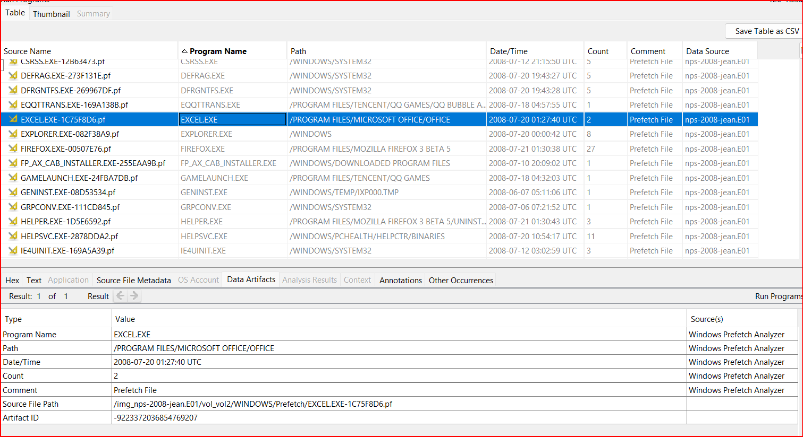
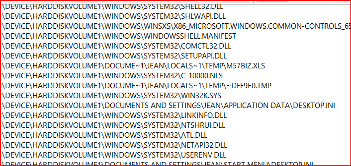

## After the leak

I wanted to find out if any other user emailed about the file, and if Jean opened the website to confirm. We found no evidence of Jean ever visiting that website, and no evidence of any attempt to hide her actions.

- **07-20 23:41 / 23:47.** Real Alison: "what is going on?" and "Something very strange is going on." Jean answers about a business trip (her browser shows hotel searches at the same time) and "Network's running kind of slow. Did we have a break-in?"
- **07-20 23:53.** Bob was told his name and SSN were posted online.
- **07-21 00:04 / 00:46.** Bob asks if Jean's SSN and salary are real. They match the spreadsheet. Jean confirms. Bob mentions these emails might be used in court.
- **07-21 00:10.** Carol, the webmaster, asks if Jean put real data in the database.
- Jean's Deleted Items only has Google Alerts and CNN forwards. She kept every attacker email and her reply.

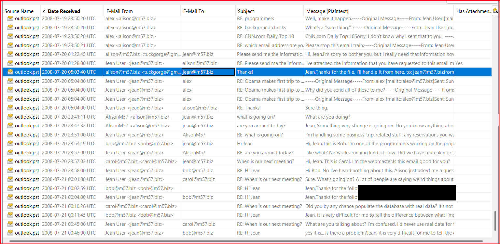
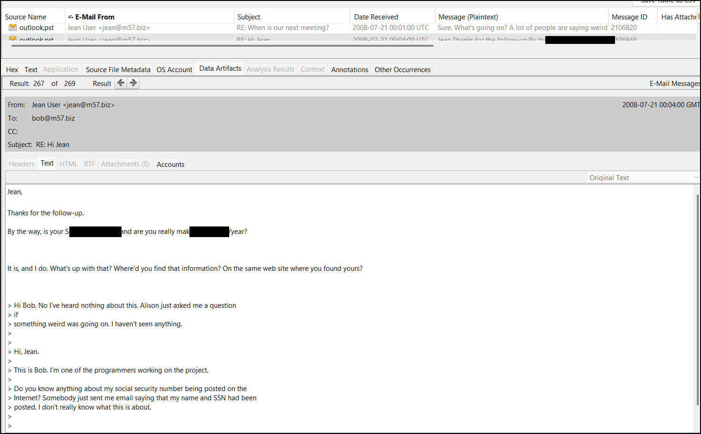
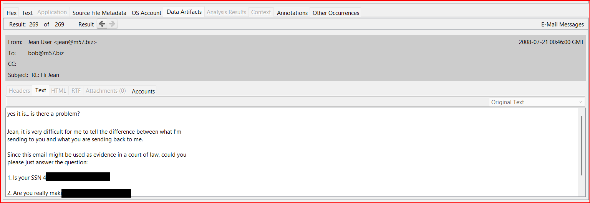
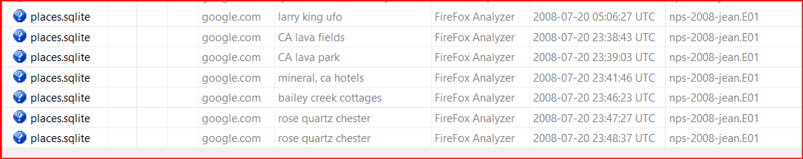
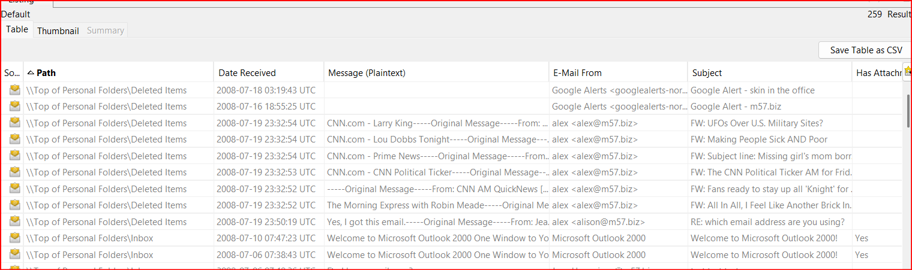

## Ruled out

- **Web history (IE and Firefox):** company name searches, news, trip planning. Nothing about the request or the leak.
- **Downloads:** three installers (Flash, Firefox, AIM).
- **AIM:** launched 07-20 23:49, no screen name, logs or file transfers.
- **Webmail:** none.
- **VMware drag-and-drop folder:** created at login, empty.
- **Recycle Bin:** `tag-cloud.jpg`, deleted 07-11.
- **Deleted files around the leak:** Windows system files only.

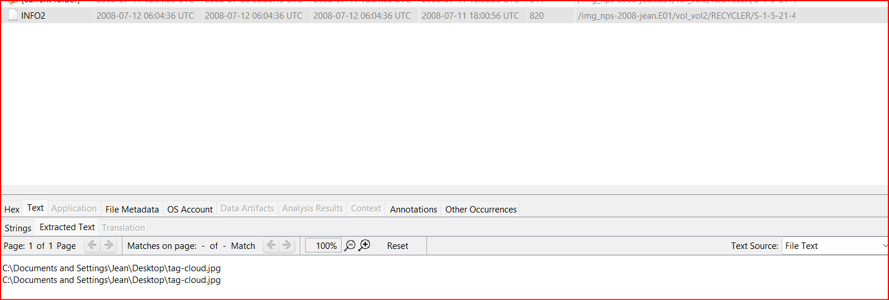

## Verdict

Jean was a victim of a business email compromise (BEC) style attack, also called spear-phishing or CEO fraud. Alison's account itself wasn't hacked; the attacker spoofed her email address. The attacker asked Jean to send company personnel information (employee names, salaries and SSNs), and Jean responded to that email with the information.

Before this, there was already confusion with Alison's misconfigured email. On top of that, the attacker said the information was for potential investors and background checks, and rushed her. The attacker also deliberately asked her not to include the instructions in her replies. All signs of typical spear-phishing.

Jean's laptop was not hacked. She sent the file herself, because she was deceived.

The laptop shows how the data left. Finding out who the attacker was would take evidence outside this image: the hosting provider's logs, the Gmail account's records, and Alison's own computer.

## What I couldn't prove

- Where the file was attached from at 01:27:27
- Why Devon has 4 logins but one profile session (security auditing was off)
- Why Alison's real emails came from a machine named `jean13fbf038a3` (probably how the scenario was built)
- Outlook keeps sent times to the minute, so "01:28" means some time in that minute

## Lessons learned

The case taught me there can be false alarms: one artifact looks like a clue, and when you investigate deeper it turns out to be something else. For example, at first we thought Jean created the file, but we found out it was created before. And we still haven't found out how it came to Jean's laptop.

Next time I will take cleaner notes. Also, if possible, I'll note any time zone errors or time discrepancies as I go, since we found a 4-hour bug.

**The 4-hour bug.** Some Autopsy modules showed times 4 hours off (my local EDT offset applied twice): Last Login, Excel metadata, Shell Bags and Installed Programs. The spreadsheet's own properties say created 15:13:51 and saved 01:28:03, while Autopsy showed 19:13:51 and 05:28:03. It was unexpected to see that error. I would like to test with other cases and find out if the bug depends on the case or is a default bug in the tool and this version.

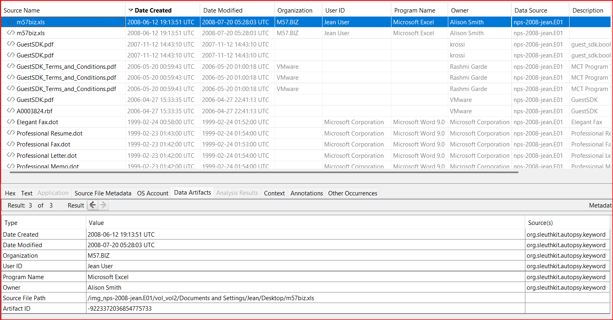

## Tools

Autopsy 4.22.1, Git Bash (`sha256sum`, `md5sum`), and small Python scripts to decode `MountedDevices`, volume GUID times, Jean's `NTUSER.DAT` and the spreadsheet's properties.

> Screenshots with SSNs or salaries are redacted. Names in the case are from the fictional M57 scenario.
