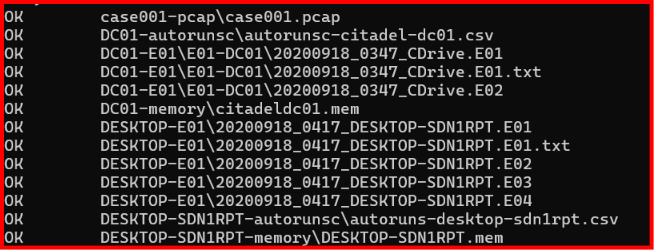
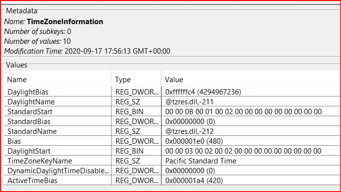
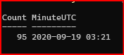
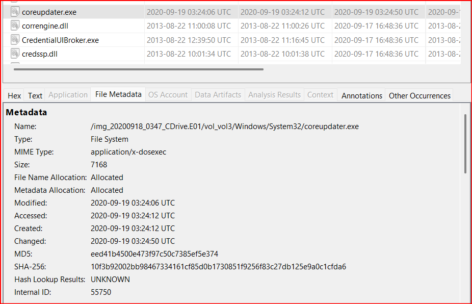
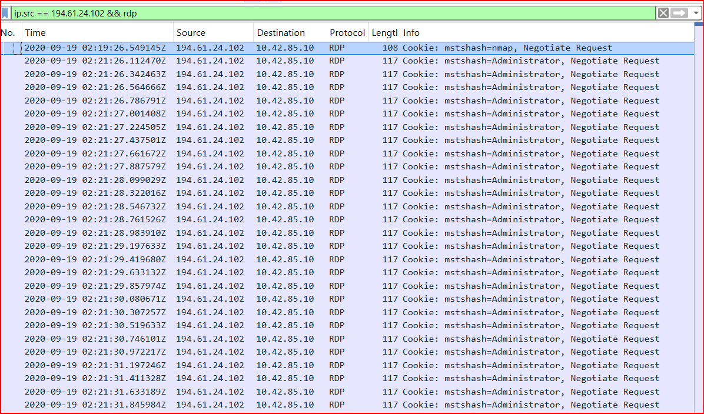
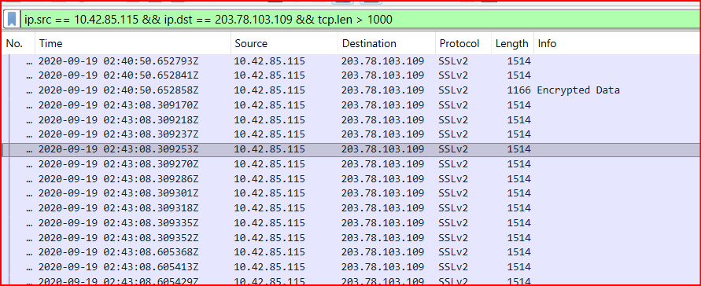
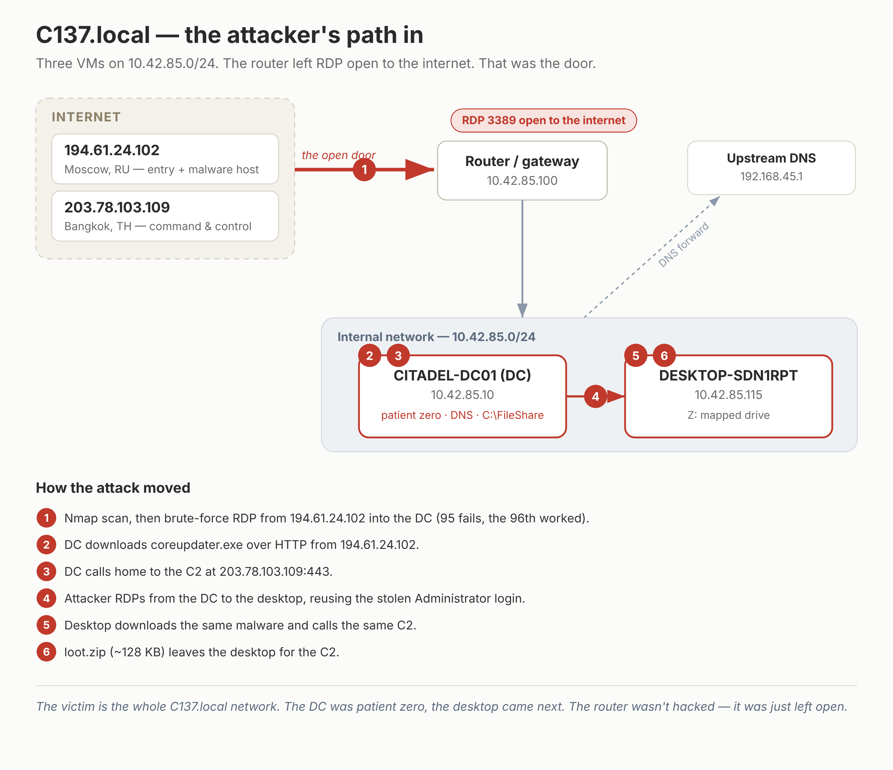
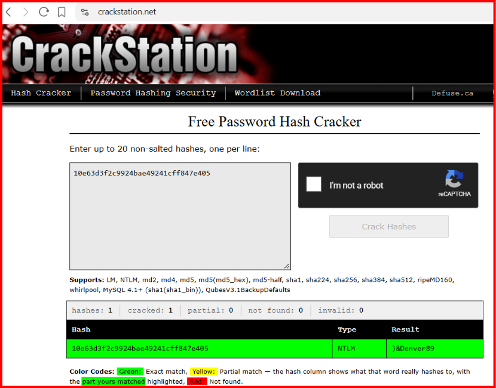

# Turnabout Sauce

*Case 3 — The Stolen Szechuan Sauce (DFIR Madness)*

Someone broke into a domain controller, dropped malware on it, read and tampered with the secret files, and a file called `loot.zip` walked out the door. This is how I worked the case. Step by step, in the order I actually did it, and for every step, why I took it.

> **Lab note.** This is a practice case built on the public [DFIR Madness "Stolen Szechuan Sauce"](https://dfirmadness.com/the-stolen-szechuan-sauce/) dataset. "C137.local" and everyone in it (Rick, Morty, Beth) are made up. No real organization or data is involved. The clean, game-free version for a leadership audience is in [`incident-report.md`](./incident-report.md).

I had one rule for myself. No piece of evidence goes in this write-up without the story of how I reached it. A fact with no trail behind it is like finding a knife in the court record and nobody remembering who brought it in. So this reads in the order I investigated, not the order the attack happened. For the attack in order, skip to the [Attack timeline](#attack-timeline).

---

## Evidence handling first

Before I touched anything, I copied the evidence and worked only on the copies. The originals went on a separate drive, read-only. I took a SHA-256 of every working file first (`hashes-working-before.txt`), so at the very end I could prove nothing changed while I worked. The first hash and the last hash are the two bookends of the whole case.

*Hashes taken before I started, checked again at the end. All 12 files matched.*

The evidence: the DC disk image, the desktop disk image, both memory dumps, the network capture (`case001.pcap`), and the Autoruns CSVs. My tools were Autopsy 4.22.1, Volatility 3, Wireshark, Eric Zimmerman's tools, and impacket. I also wrote down the acquisition details and checked each image's hashes inside Autopsy before I trusted a single artifact from it.

A couple of things went wrong early, and I'm keeping them in, because that's how the case really went. My first ingest got cancelled over a license I don't have. Later the ingest sat frozen for about 21 hours because my laptop fell asleep with the lid shut. Small problems, but real ones. Next time: sleep set to Never on AC, lid does nothing.

---

## The investigation

### 1. What is this server? (Q1)

I started with the DC's `SOFTWARE` hive, because before anything else I need to know what I'm looking at.

It's **Windows Server 2012 R2 Standard (Evaluation)**, build 9600, installed 2020-09-17 at 16:43:59 UTC. That comes from `Microsoft\Windows NT\CurrentVersion`: the product name, `EditionID = ServerStandardEval`, and the install date.

### 2. What time does it think it is? (Q3)

This one looks small, but it set up the biggest puzzle of the whole case. If I don't know the machine's clock, every timestamp after this is built on sand.

From the `SYSTEM` hive, the time zone is **Pacific Standard Time (UTC-8)**, with daylight saving on, so UTC-7 at the time of the incident.

But something was already off. The case page calls the box UTC-6, the registry says Pacific, and the acquisition log times don't match the file names either. So I wrote "the clocks don't agree" in my notes and kept moving. That note comes back later, and it changes everything.

### 3. Was there a breach, and how did they get in? (Q4, Q5)

I exported the DC's `Security.evtx` and counted the logons, because a brute force leaves a very specific fingerprint.

There were 2,540 successful logons and 96 failures. The failures were the tell. **95 of them were for "Administrator," over the network, with no source IP, all inside one minute** (03:21 UTC). A person doesn't miss a password 95 times in sixty seconds. A machine does.

*95 failed Administrator logons in one minute. The brute force.*

Right after the failures, there's one success, with the workstation name **"kali,"** and then an **RDP logon from 194.61.24.102**. So the way in was an automated brute force against the Administrator account over RDP. 95 misses, and the 96th opened the door.

I'll be honest about the detour, because I nearly chased the wrong thing. At first the older Administrator logins from `127.0.0.1` caught my eye and I started treating them as suspicious. Then it clicked: those are just loopback logons from when the box was being set up. The timing and the loopback address both say setup, not attacker. I also caught the server being renamed from `WIN-E0PO207ERMD` to `CITADEL-DC01` in that same window. Telling the setup noise apart from the real attack was half the work.

### 4. Did they go anywhere? (lateral movement)

The attacker was on the DC. Did they go further? I exported the `TerminalServices-RDPClient` log, because that one records the RDP connections a machine makes *outward*.

It did move. At 03:35–03:36 (DC clock) the DC opened an RDP session **to the desktop (10.42.85.115)**, stayed about 16 minutes, and disconnected at 03:52:13. So the attacker used the DC as a stepping stone into the desktop. I confirmed that later from the desktop's own logs.

### 5. Malware (Q6)

I built a timeline and limited it to executables, because a new program showing up right after a break-in is the first thing worth suspecting.

One file didn't belong. **`coreupdater.exe`, sitting in `C:\Windows\System32`**, created 03:24:12, about two and a half minutes after the attacker's RDP logon. HOLD IT. An "updater" in System32, appearing right after the attack, while every real file around it is dated install day. So I looked closer. I took the file's hash from the File Metadata tab in Autopsy and ran it through VirusTotal.

*coreupdater.exe in System32 — note the modified time sitting before the created time, and the hash I took to VirusTotal.*

That confirmed it. **64 of 71 vendors flagged it,** mostly as Rozena/Shelma, a Metasploit loader. VirusTotal's code notes showed a self-decrypting loop, RWX memory, and a second-stage payload. That's a stager.

- `coreupdater.exe`, 7,168 bytes
- SHA-256 `10f3b92002bb98467334161cf85d0b1730851f9256f83c27db125e9a0c1cfda6`

One thing I flagged for later: its modified time was *earlier* than its created time. A file can't be edited before it exists, unless it was born somewhere else and carried in. Shell Bags answered that one.

### 6. Persistence and privilege escalation

Malware that wants to survive a reboot sets itself to start on its own, so I checked Autoruns.

It was there. **`coreupdater` had registered itself as a Windows service,** auto-start, running as LocalSystem, unsigned, pointing at the file in System32. To find *when*, I read `System.evtx` through PowerShell and found the **service installed at 03:27:49** (event 7045), minutes after the file landed.

The same log had something stranger: a handful of random-named services, `outmgo`, `mszhao`, `pmhrio`, each doing `cmd.exe /c echo <name> > \\.\pipe\<name>`. That's the signature of Meterpreter's `getsystem`, reaching for SYSTEM through a throwaway service. So I could see the escalation attempts, not just assume them.

One thing that looked like attacker tooling turned out to be ours. An `AccessData` driver showed up at 04:39:59. That's FTK Imager, the responder capturing memory, not the attacker. The people who collect the evidence leave footprints too, and it's my job to tell them apart.

### 7. The PCAP, two clocks, and a GOTCHA

Here's where that "the clocks don't agree" note from step 2 finally paid off. I opened `case001.pcap` in Wireshark to confirm the brute force on the wire and to pin down real times.

First, a trap. I set the view to UTC and checked Capture File Properties, but **Wireshark shows the host's own local time there, no matter what the view is set to.** So the "first packet" time it handed me was in the capture machine's zone, not UTC.

Then the dead end I'm keeping. I first converted with today's offset (UTC-5), which put the first packet at 22:58:07 and lined up almost too neatly with the DC logs. Almost. That's usually the sign something's wrong, and it was. I checked the very first packet with no filter at all, and the capture actually starts at **21:58:07 UTC**. The Properties window had quietly used EDT, the 2020 offset. Lesson learned the slow way.

Then the real find. I filtered to just RDP from the attacker's IP. **GOTCHA! Psyche-Lock broken.**

At 02:19:26 there's one `mstshash=nmap` request, the scan. From 02:21:26 there's a steady stream of `Cookie: mstshash=Administrator`, four or five a second, each about 0.22 seconds apart. That's a machine, not a pair of hands. And the last few successes line up with the DC's logons **exactly one hour apart.**

So the DC's clock was running **one hour ahead of the network.** Every DC timestamp in this case is an hour later than the real time on the wire. `coreupdater` at 03:24 on the DC is really 02:24. The same attack, written down on two clocks, and I only caught the gap by laying them side by side.

My rookie tip to myself: never trust one clock. Before you build a timeline, check it against a second source, a capture or another machine's logs. One clock lies with a straight face.

*From here on, I give the machine's clock time with the network time in brackets where it matters.*

### 8. Where is the attacker? (Q6.2)

The way in and the malware download came from the same box, **194.61.24.102**. An IP lookup (as of 2026-11-06) puts it in **Moscow, Russia**, and ipinfo flags it as an anonymizing service. So it tells me where the connection came from, not where the attacker was sitting.

### 9. How did the malware get on the machine?

I filtered the PCAP for frames containing "coreupdater," because if it was downloaded, the download is right there on the wire.

The attacker hosted it on their own web server at 194.61.24.102. The DC asked for `/coreupdater.exe` over plain HTTP at **02:24:06** (network), and Wireshark's Export Objects showed the download at **7,168 bytes,** the same size as the file on disk. That download at 02:24:06 network is 03:24:06 on the DC, which is the file's modified time, and it appeared in System32 six seconds later. That solves the "modified before created" riddle: it was downloaded into Downloads, then moved into System32.

### 10. What did the malware call home to? (Q8)

A loader pulls down a bigger payload and phones home. A domain controller should almost never start its own connections to the internet, so I filtered for new outbound connections from the DC to anything outside the local network.

One suspect came up: **203.78.103.109 on port 443.** The first callback is at 02:25:18 (network), about a minute after the download, and the first `getsystem` service follows 26 seconds later. Download, run, call home inside a minute, settle in. The desktop did the exact same dance later. With VirusTotal already calling it a Metasploit loader, that makes **203.78.103.109 the command-and-control server.**

### 11. The desktop (Q2, and how they got in)

Now the second machine. From the desktop's `SOFTWARE` hive: **Windows 10 Enterprise (Evaluation), release 2004, build 19041.264,** installed 2020-09-18 05:47:03.

There's a trap in that hive. The `CurrentVersion` value reads "6.3," but that's a compatibility leftover, not the real version. The real one hides in `ReleaseId` and `CurrentBuild`.

**`coreupdater.exe` was on the desktop too,** same 7,168 bytes, same SHA-256 as the DC copy. Its Prefetch file proved it ran, once, at 03:40:49 on the desktop (02:40:49 network), the exact second the desktop reached out to 203.78.103.109. It starts and calls home in the same breath.

How did it get there? The same way as the DC, but from the inside. The attacker RDP'd from the DC at 03:36:24 using the Administrator account they'd already brute-forced, so there was nothing left to guess. Then the desktop downloaded `coreupdater.exe` from the attacker's web server, ran it, registered the service, and escalated. I confirmed the lateral movement from both sides: the desktop's `Security.evtx` shows an RDP logon from 10.42.85.10 at 03:36:24, matching the DC's RDPClient log to the second.

### 12. Inside memory (Q7)

I ran Volatility 3 on both memory images, because the process list and the injected code show me what the malware *became*.

`coreupdater.exe` ran as PID 3644 on the DC and 8324 on the desktop, both holding the C2 connection in `netscan`. It used `getsystem` to reach SYSTEM, then slipped into **`spoolsv.exe`,** the Print Spooler, and exited, while the connection to the C2 stayed warm. `malfind` found injected code in `spoolsv.exe` on both machines. On the DC it was the Metasploit shellcode prologue and a reflective-loader stub sitting in RWX memory, hiding inside a process nobody looks at twice.

One question I couldn't close: who actually pulled the trigger on `coreupdater`. The parent process had already exited before memory was captured, so memory can't name it. The timing says the attacker launched it by hand, about 30 seconds after the second RDP logon, but "says" isn't "proves." So I'm leaving that lock shut.

### 13. The secret files (Q11, Q12, and Beth's note)

The DC timeline showed the Administrator account opening files in `C:\FileShare\Secret` during the attacker's session. That's why I went looking for them. The timeline pointed, so I searched by name.

- **`Szechuan Sauce.txt`** was opened again by Administrator at 03:32:21, in the middle of the session. The jump list says it was opened in Notepad.
- **`PortalGunPlans.txt`** was opened at 03:32:02.
- **`SECRET_beth.txt`** was opened at 03:32:13, **edited at 03:34:27, and then deleted.**

Then the tampering, and this is the part that bothered me. A new file, **`Beth_Secret.txt`,** wears setup-day timestamps, but its shortcut wasn't created until the next day at 03:35:07. Its fake times copy the minute and second of `PortalGunPlans.txt`, one hour off. That's time-stomping, a file wearing a costume. When I read both:

- The original `SECRET_beth.txt` says *"Earth beth is the real beth."*
- The planted `Beth_Secret.txt` says *"Space Beth is the real Beth"*

So the attacker opened the real note, edited it, deleted it, and left behind the opposite story, dressed up to look like it had been there since the beginning. (For the bonus questions: the original name was `SECRET_beth.txt`, and the time-stomped file is `Beth_Secret.txt`.)

A word on the Shell Bags. Every date in Autopsy's Shell Bags output was four hours ahead, the same tool bug I hit in Case 2. I subtracted four hours from all of them and checked each against known logon and install times before I trusted a single date. Burned once, careful twice.

The Shell Bags also answered whether someone moved the malware (Q6.6). On the DC, System32 was browsed at 03:24:44 and Downloads changed at 03:24:52, right on the heels of the download, so yes, the attacker carried `coreupdater.exe` into System32 with Explorer. On the desktop, the attacker wandered through Users, the Admin pictures, Morty's and Rick's folders and their Saved Games from 03:45 to 03:51, right before disconnecting. Were they looking for more? What were they after? That browsing is exactly what sent me chasing `loot.zip`.

### 14. loot.zip, the bag that walked out

I cut the desktop timeline down to the useful artifacts (Recent Documents, Shell Bags, web activity) to clear out the normal Windows noise. That view surfaced a file called **`loot.zip`,** opened during the attacker's session. With a name like that, it had my full attention.

I searched for it by name and got three hits: a shortcut, a jump-list entry, and the target path `C:\Users\mortysmith\Documents\loot.zip`. But **there was no actual `loot.zip` on either machine, not even a deleted one.** It was opened out of Morty's Documents, and the bag itself was gone.

Did it leave the network? I filtered the PCAP for big packets going from the desktop to the C2.

There it was. **About 100 full-size packets, roughly 128 KB, fired from the desktop to 203.78.103.109 in about two milliseconds at 02:47:06 (network), 48 seconds after `loot.zip` was opened.** On the I/O graph it stands over the rest of the hour like a single tall spike on a flat field. The traffic is encrypted, so I can't read it, but the size and the timing are consistent with `loot.zip` leaving over the C2.

Two dead ends here, and I'm keeping both.

Earlier I'd parked a huge spike of about 27,000 packets and wondered if it was the attacker copying the Secret folder from the DC to the desktop. My first try at finding it used the wrong time axis and showed only about 135 packets, because I read the graph wrong. When I found it properly, it was a 39 MB download *coming in* to the desktop from a Microsoft content server, about 37 seconds after the new Administrator profile was created. So it's Windows dressing the new profile, not the attacker stealing anything. It's pouring in, not going out. Benign.

I also checked whether the DC sent its own burst around the time the sauce was opened. It didn't, only about 11 KB over seven minutes, no upload. The sauce file is only 478 bytes, so it could ride inside normal encrypted C2 traffic, or it was simply read on screen in Notepad over RDP. I can't confirm it, so I don't claim it.

**Breaking the lock without the bag.** The zip was deleted and its record reused, so I couldn't recover the file itself. I checked the Deleted Files view on both images and ran a PhotoRec carve, 422 files, no matching zip. Dead end for recovery. But the shortcut snitched.

I parsed `loot.zip.lnk` with LECmd. A shortcut keeps its target's path, size, and timestamps even after the file is long gone, like a receipt in an empty bag:

- Target: `C:\Users\mortysmith\Documents\loot.zip`
- **Size: 131,041 bytes,** which matches the exfil burst
- Built and opened 03:46:15–18 on the desktop, by the Administrator account

Then the part that settled it. The three files in Morty's Documents that were read in that same three-second window, when nothing else in the folder was touched:

| File | Size (bytes) |
|---|---|
| Portal_gun.png | 130,678 |
| Plans.txt | 141 |
| My Social Security Number.txt | 22 |
| **Total** | **130,841** |
| **loot.zip (from the shortcut)** | **131,041** |
| **Difference** | **200** |

A 200-byte gap, which is exactly the overhead of a zip holding three files. The contents add up to the byte. So `loot.zip` held Morty's portal-gun image, the plans, and an SSN file, and that's the roughly 128 KB that went out to the C2. I never got to open the bag, because the attacker burned it. I rebuilt it anyway, from the receipt, the timestamps, and the weight.

### 15. Where is the C2 from, and is it known? (Q7.1, Q7.2)

An IP lookup (as of 2026-11-10) puts **203.78.103.109 in Bangkok, Thailand,** on a hosting network, also flagged as privacy/anonymizing. So there are two IPs, in two countries, with two different providers. Moscow for breaking in and handing over the malware, Bangkok for the remote control. The attacker split the jobs on purpose. It's common practice, and smart: if one address gets blocked, the other keeps working.

The useful part was VirusTotal's Relations tab. One of the files talking to 203.78.103.109 is **`coreupdater.exe`,** the same 64/71 malware. So a public, independent source ties the C2 to our malware, matching the PCAP and memory. As for other attacks around the same time, I found no clear sign of any. The other related files were scanned years later, or are other investigators' uploads of this same case.

### 16. Last known contact (Q13)

I checked the last packets for both IPs.

For 194.61.24.102, the last contact was at 02:57:41 (network), when the attacker logged themselves off the DC. For 203.78.103.109, the C2 was still talking when the recording stopped. Its last packet is at 05:38:51, six seconds before the capture ends, with no FIN, so the connections never closed. Three sessions sat open, one on the DC and two on the desktop, each sending a small heartbeat every 60 seconds, like a pulse nobody switched off. So the attacker's access was still alive when the evidence was collected. Memory agrees: both machines held ESTABLISHED connections to the C2.

One more dead end, kept. My first attempt to find the last packet was sorted by the wrong column, so "End" gave me the wrong answer. Sorting by packet number fixed it.

### 17. Who logged on, the network, and a clean Autoruns sweep

To find out who really logged on to each machine, I read the successful logons from both Security logs and grouped them by user and logon type. Only types 2, 7, 10, and 11 count as really logging on. Type 3 just means an account was used over the network. Only **Administrator** really logged on to the DC (setup, the responder, and the attacker's four RDP logons). The desktop saw Rick, Morty, the local `Admin`, the setup `defaultuser0`, and the attacker's Administrator over RDP from the DC.

For the network (Q9), the victim is the whole **C137.local** network: `CITADEL-DC01` (10.42.85.10), `DESKTOP-SDN1RPT` (10.42.85.115), and the router (10.42.85.100), all VMware virtual machines on `10.42.85.0/24`. The DC is the domain's DNS server and forwards upstream to 192.168.45.1. It hosts `C:\FileShare`, and the desktop has a `Z:` mapped drive. The router was set up to allow inbound RDP from the internet straight to the DC. **That router was the open door.** There's no evidence the router itself was compromised, but it didn't need to be. It just had to be left open.

*C137.local. The open RDP path from the internet to the DC is the root cause.*

Last, I ran a full Autoruns review on both machines, filtering for anything not signed by Microsoft or VMware, to be sure nothing else was hiding in the dark. There was only `coreupdater`, some signed Intel and AccessData drivers, and standard Windows leftovers. One odd DC entry, "30000 / cd /d," turned out to be a built-in Windows default. No second backdoor, no scheduled task, nothing else. The defense rests.

### 18. The password that started it all (Bonus Q6)

The last question was the password itself, the one those 95 failures were hammering at. The DC is a domain controller, so the domain hashes live in Active Directory's `NTDS.dit`, not the local SAM. I extracted `NTDS.dit` and the `SYSTEM` hive from the DC image and dumped the hashes with impacket's secretsdump.

The tooling fought me the whole way, and that's part of the story. My Volatility build didn't ship the hashdump plugin, so I went to `NTDS.dit` on disk instead. Then Windows Defender grabbed impacket's scripts as a hacktool mid-install, which is normal for offensive tooling, so I set a Defender exclusion for my tools folder. After that it ran.

secretsdump handed over the whole domain. I carried the Administrator hash to CrackStation.

The Administrator password was **`)&Denver89`.**

And here's the part worth remembering, because it surprised me. The password *looks* strong. Upper and lower case, numbers, two symbols, ten characters. It would pass almost any complexity policy with a gold star. But CrackStation reversed it in seconds, which means it was already sitting in a public breach list. So complexity was never the problem. The password was known and reused, the lock on the door was a lock everyone already had the key to, and with no account lockout, the brute force simply walked in on the 96th try.

(One small bonus: the Guest account's hash is the well-known hash of a blank password, which is the normal disabled default.)

---

## Attack timeline

All times are **network (real) time.** The DC and desktop clocks both ran **one hour ahead,** so add an hour for what the machines' own logs show.

| Time (UTC) | Event |
|---|---|
| Sep 18 21:58 | Capture starts; DC comes up on the network |
| Sep 19 02:19:13 | Nmap scan from 194.61.24.102 |
| 02:21:26–47 | RDP brute force of Administrator (95 failures) |
| 02:21:48 | Successful RDP logon from 194.61.24.102 |
| 02:24:06 | DC downloads `coreupdater.exe` over HTTP |
| 02:24:12 | `coreupdater.exe` moved into `C:\Windows\System32` |
| 02:25:18 | DC first C2 callback to 203.78.103.109:443 |
| 02:25:44 | First `getsystem` service (SYSTEM escalation) |
| 02:27:49 | `coreupdater` service installed on DC |
| 02:32:02–21 | Attacker opens PortalGunPlans, SECRET_beth, Szechuan Sauce |
| 02:34:27 | `SECRET_beth.txt` edited, then deleted |
| ~02:35 | `Beth_Secret.txt` planted and time-stomped |
| 02:36:24 | RDP from DC to desktop (reused Administrator creds) |
| 02:39:58 | Desktop downloads `coreupdater.exe` |
| 02:40:49 | Desktop runs it; first desktop C2 callback |
| 02:42:42 | `coreupdater` service installed on desktop |
| 02:45–02:51 | Attacker browses Morty's and Rick's folders |
| 02:46:18 | `loot.zip` built in Morty's Documents (131,041 bytes) |
| 02:47:06 | ~128 KB sent to the C2 (loot.zip) |
| 02:52:13 | RDP DC to desktop disconnected |
| 02:56:04 | Attacker's second RDP logon to the DC |
| 02:57:41 | Attacker logs off the DC |
| 05:38:51 | C2 still beaconing when the capture ends |

---

## Indicators of compromise

| Type | Value |
|---|---|
| Entry / malware-host IP | `194.61.24.102` (Moscow, RU; anonymizing) |
| C2 IP | `203.78.103.109:443` (Bangkok, TH; hosting) |
| Malware | `coreupdater.exe`, 7,168 bytes |
| SHA-256 | `10f3b92002bb98467334161cf85d0b1730851f9256f83c27db125e9a0c1cfda6` |
| MD5 | `eed41b4500e473f97c50c7385ef5e374` |
| Persistence | service `coreupdater` @ `HKLM\SYSTEM\CurrentControlSet\Services\coreupdater` |
| getsystem services | `outmgo`, `mszhao`, `pmhrio` (DC), `nehgye` (desktop) |
| Injected process | `spoolsv.exe` (both machines) |
| Taken | `loot.zip` (131,041 bytes): `Portal_gun.png`, `Plans.txt`, `My Social Security Number.txt` |
| Tampered | `Beth_Secret.txt` (time-stomped, replaced `SECRET_beth.txt`) |

---

## What I'd change

The root cause is simple. The DC's RDP was reachable from the internet. On top of that, the Administrator password was known and reused, the same credentials worked on the desktop, and there was no account lockout. And the attacker still had live C2 when the evidence was collected.

**Contain it now:**
1. Only let the DC talk to the destinations it actually needs while we investigate. Don't put it back on the open internet. Block `194.61.24.102` and `203.78.103.109` at the firewall.
2. Block RDP to the DC from the internet, and turn off any port forwarding or firewall rule that lets the internet reach it. Only allow RDP through an approved VPN or gateway.
3. Remove the `coreupdater` service and file from both machines (or better, rebuild them), and reset the Administrator password and all domain credentials, since the attacker had SYSTEM on the DC.
4. After containment, have AD specialists check whether the domain can be cleaned up as it is, or needs to be rebuilt.

**Fix it for good:**
1. Allow remote access only through a VPN with MFA, an RD Gateway, or a managed bastion service, and restrict inbound traffic at the firewall or security group.
2. Use MFA for remote access, and give every account its own strong password. And screen passwords against known-breached lists, because `)&Denver89` passed complexity and still fell instantly. Set a lockout, following Microsoft's baseline: lock the account for 15 minutes after 10 wrong passwords, and reset the counter after 15 minutes. Here, 95 wrong passwords in one minute went through with no lockout at all.
3. Give each account only the rights it needs, and use separate admin accounts for servers and desktops. Don't use the domain Administrator account for everyday logons.
4. Limit where domain controllers can reach on the internet, and watch that traffic.
5. Set up alerts for repeated failed logons and unexpected RDP logons, and actually review the logs.
6. Turn on process-creation logging (event 4688, with command lines), sync every clock to one reliable time source, and send the logs to a SIEM the attacker can't reach.

### Mapped to CIS Controls v7.1 (Bonus B1)

- **Control 4, Controlled Use of Administrative Privileges.** The attacker cracked the domain Administrator password, and one reused credential opened both machines. Separate admin accounts, strong unique passwords, and no domain-Admin RDP would have made this much harder. (NIST SP 800-53 AC-6 backs this up.)
- **Control 9, Limitation of Ports, Protocols, and Services.** RDP was open to the internet and found by Nmap. If we had been scanning our own network, we'd have found the open port before the attacker did.
- **Control 12, Boundary Defense.** The attack crossed the boundary both ways: inbound brute force, and outbound HTTP download plus hours of C2 beaconing. A firewall, an IDS, and an IPS would each have had a chance to catch it.
- **Control 16, Account Monitoring and Control.** 95 failed logons with no lockout, then an Administrator logon from a foreign IP with no alert. Lockout and monitoring stop this at the brute force. (NIST SP 800-63-4 backs this up.)

### One major architecture change (Bonus B2)

There are three options: take the DC off the internet and allow admin access only through an RD Gateway or jump box with MFA; segment servers from workstations, since the attacker went from the DC to the desktop with nothing in between; or add central logging and monitoring with a SIEM. The company has to decide what fits based on cost, time, and staffing. My pick is the SIEM. The immediate fixes above already close the RDP door, so the biggest gap left is visibility. Nobody saw the 95 failed logons, the Administrator logon from a foreign IP, the new services, or the hours of beaconing. A SIEM would have caught all of it. It isn't hassle-free, it needs tuning and someone watching it, but it covers the blind spots the other options can't.

### Policies (Bonus B3)

Controls only work if there are policies behind them. I'd focus on three: a password policy (long, unique, no reuse, and screened against breach lists); a remote-access policy (RDP only through a VPN or gateway with MFA); and an account-lockout policy (the lockout above). One more would help: a logging and audit policy that decides what gets logged (4625, 4688, 7045), how long logs are kept, and syncs every clock to one time source. With that, the evidence would already be waiting for us, and the timelines would line up without fighting a one-hour skew like I did.

---

## Psyche-Locks

**Broken:**
- The one-hour clock skew between the machines and the network.
- `loot.zip`, deleted and unrecoverable, but its contents rebuilt from the shortcut's size and the access times.
- The Administrator password.

**Still open, honestly:**
- Who launched `coreupdater`. The parent process had exited before memory was captured. The timing points to the attacker by hand, but I can't prove the parent.
- Whether the Szechuan sauce recipe itself was taken. It was opened in Notepad over RDP, the DC sent no bulk upload, and the C2 traffic is encrypted, so a 478-byte file can't be confirmed either way.

---

## Tools

Autopsy 4.22.1 · Volatility 3 · Wireshark · Eric Zimmerman's LECmd · impacket (secretsdump) · CrackStation · VirusTotal, AbuseIPDB, ipinfo

## Integrity

Every working file was SHA-256 hashed before I started and checked again at the end. They all matched. The originals stayed read-only on separate media the whole time.
